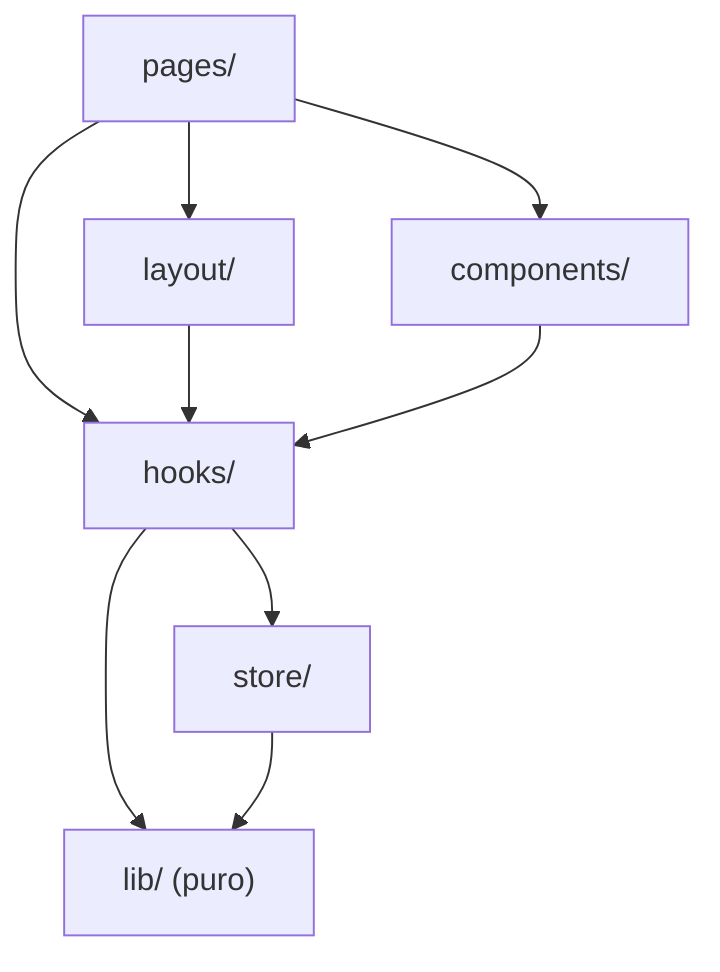
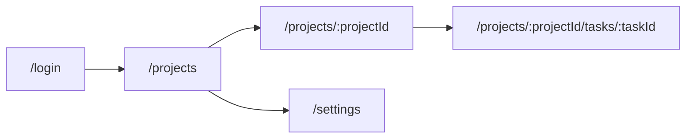
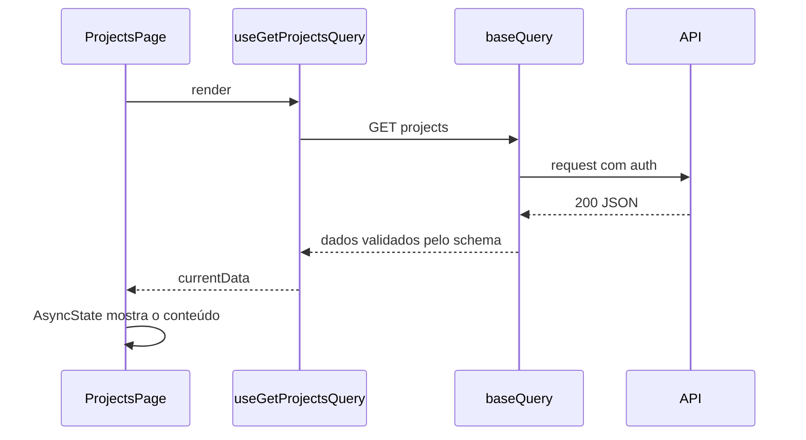

# Plan

> **TL;DR:** O plano não é só uma lista de passos: ele **desenha como o projeto vai ficar**. Ele é escrito em `docs/PLAN.md`, na pasta do projeto novo, e o usuário aprova abrindo esse arquivo: a árvore, as camadas, as rotas, o caminho dos dados, a tela do esqueleto e a paleta. Depois de aprovados, os desenhos vão para a documentação do projeto.

## Where the plan lives

| Regra | Detalhe |
| --- | --- |
| Arquivo, não chat | O plano inteiro (as 9 partes abaixo) vai para `<projeto>/docs/PLAN.md`, com os diagramas Mermaid, para o usuário abrir renderizado no editor |
| Única exceção à regra 1 | Antes da aprovação, a pasta do projeto pode ter só `docs/PLAN.md`; nenhum outro arquivo e nenhum comando de scaffold |
| No chat | Um resumo de até 10 linhas, o caminho do arquivo e a pergunta de aprovação |
| Mudança pedida | Edite o `docs/PLAN.md` nas partes afetadas e peça aprovação de novo, citando o que mudou |
| Depois de aprovado | A primeira linha do arquivo vira `Status: aprovado em AAAA-MM-DD`; ele fica como registro do que foi combinado |

❌ Errado: plano colado no chat, com Mermaid que o terminal não desenha; o usuário aprova sem ver os diagramas, e o plano se perde na conversa.

✅ Certo: `docs/PLAN.md` escrito com as 9 partes; o chat diz "Plano em `<projeto>/docs/PLAN.md`: estrutura em camadas, 20 passos, histórico atrás de env. Pode seguir?".

## Plan contents

| # | Parte | Formato |
| --- | --- | --- |
| 1 | Resumo das decisões (produto, estrutura, stack) | Tabela: decisão, escolha, ADR |
| 2 | **Árvore de pastas final** | Bloco `text` com a estrutura escolhida em E1 e as features reais |
| 3 | **Camadas e direção dos imports** | Diagrama Mermaid `flowchart` |
| 4 | **Mapa de rotas** da v1, com a jornada principal destacada | Diagrama Mermaid `flowchart` |
| 5 | **Caminho dos dados** de uma tela do esqueleto | Diagrama Mermaid `sequenceDiagram` |
| 5b | **Mapa de endpoints** da v1: tela, endpoint, **para que serve**, payload e fonte no backend | Tabela de [BACKEND.md](BACKEND.md) → What to extract |
| 6 | **Wireframe** da tela do esqueleto (regiões, não pixels) | Bloco `text` com desenho em caracteres |
| 7 | **Paleta de tokens** | Tabela: token, valor, origem (referência ou provisório) |
| 8 | Passos do scaffold e libs que serão instaladas | Tabela de [SCAFFOLD.md](SCAFFOLD.md) com as escolhas aplicadas |
| 9 | O que fica simulado e o que fica para depois | Lista curta |

## Drawing rules

- Use os nomes reais: telas, rotas e entidades do `CONTEXT.md`, nunca `Foo` ou `Item`.
- Um desenho por assunto; nada de um diagrama gigante com tudo.
- Os desenhos mostram a **decisão tomada** no grill. Se o desenho revela uma dúvida nova, ela volta para o grill antes da aprovação.
- Se o usuário pedir mudança no plano, redesenhe as partes afetadas antes de pedir aprovação de novo.
- Se o ambiente tiver uma ferramenta de página ou documento compartilhável, ofereça publicar o `docs/PLAN.md` por lá também, para ver os diagramas sem editor.

## Templates

Os exemplos usam um app neutro de projetos e tarefas; troque pelos nomes do projeto real.

**Camadas e direção dos imports** (estrutura de camadas por tipo):



**Mapa de rotas:**



**Caminho dos dados** de uma tela:



**Wireframe** da tela do esqueleto:

```text
┌──────────────────────────────────────────────────┐
│ TopBar: logo · busca · avatar                     │
├────────────┬─────────────────────────────────────┤
│ Sidebar    │ Projetos                  [+ Novo]  │
│ Projetos   │ ┌────────────┐ ┌────────────┐       │
│ Tarefas    │ │ ProjectCard│ │ ProjectCard│       │
│ Ajustes    │ └────────────┘ └────────────┘       │
│            │ (carregando: os cards viram skeleton)│
└────────────┴─────────────────────────────────────┘
```

**Paleta de tokens:**

| Token | Claro | Escuro | Origem |
| --- | --- | --- | --- |
| `--primary` | valor da referência | valor da referência | Guia de marca, p. 3 |
| `--background` | valor da referência | valor da referência | Print da tela inicial |
| `--radius` | valor da referência | — | **Provisório**: sem referência |

## After approval

- Os desenhos 2 a 7 vão para `docs/ARCHITECTURE.md` do projeto ([PROJECT-DOCS.md](PROJECT-DOCS.md)), e o `CLAUDE.md` do projeto aponta para ele.
- Durante o scaffold, se algo precisar sair diferente do desenho, pare, mostre a diferença e peça aprovação.
- No relatório final, compare o que foi entregue com os desenhos aprovados.

## Anti-patterns

- **Plano no chat:** diagramas que o terminal não desenha e um plano que some na conversa; escreva em `docs/PLAN.md`.
